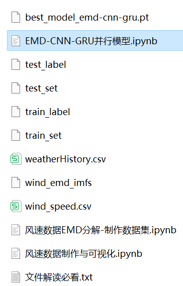
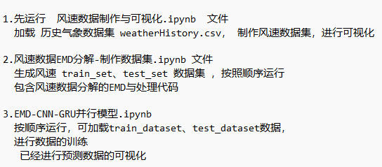
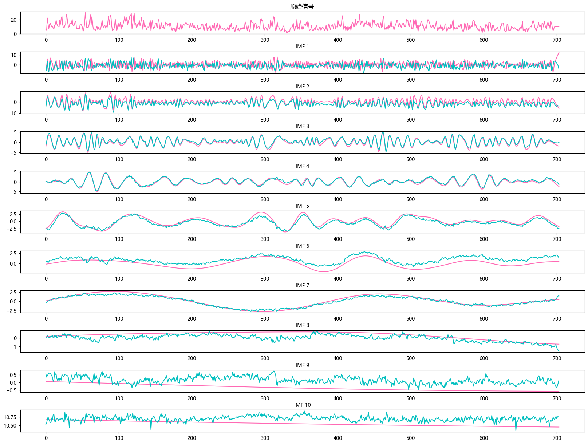

# Stepwise Wind Speed Prediction: EMD-CNN-GRU Parallel Model

The multi-feature variables include the following:
When dealing with LSTF problems, selecting an appropriate window size (window size) is very crucial. Selecting the right window size can help the model better capture patterns and features in time series. To extract longer dependencies for sequence modeling, this paper increases the window size to 96 and employs the EMD-CNN-GRU parallel model to fully extract feature information from the sequence.
This includes wind speed data, as well as the wind speed dataset and label set that have been generated and processed through EMD decomposition, and corresponding code can be run. There are also examples of EMD decomposition.
The EMD-CNN-GRU parallel model has smaller MSE and MAE, and its effect is particularly noticeable, effectively extracting effective information from long windows.
This includes the code for data EMD preprocessing and the complete EMD-CNN-GRU parallel model prediction code.
Environment: Python 3.9
\n\n(Platform shows less than the number of files in the image file explanation: The platform has a limit on the number of files uploaded, run according to the explanation file, and the data can be generated based on the uploaded code)

## Images

<!-- PAYMENT_BLOCK -->

## Get this dataset

- Payment link (Stripe): [Buy now](https://buy.stripe.com/3cs8yP7sY87d0vu9AB)
- Payment QR code: 

<!-- /PAYMENT_BLOCK -->
